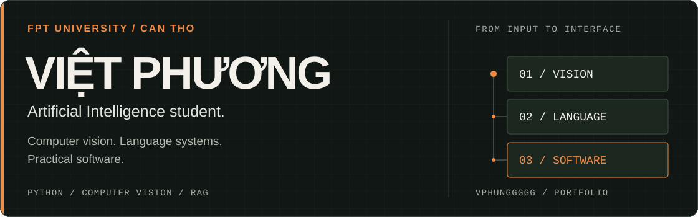

  <a href="#about">About</a> &nbsp; / &nbsp;
  <a href="#selected-work">Selected work</a> &nbsp; / &nbsp;
  <a href="#toolkit">Toolkit</a>

## About

I'm **Việt Phương**, an **Artificial Intelligence student at FPT University, Can Tho, Vietnam**.

My portfolio explores computer vision, retrieval-augmented generation and Python applications. I'm interested in the engineering around a model: handling inputs, connecting services, presenting evidence and building interfaces people can use.

## Selected work

| Project | Engineering focus |
| :--- | :--- |
| **[ThinkMed](https://github.com/VPhunggggg/thinkmed-multimodal-dermatology-ai)** Multimodal AI · Healthcare | A dermatology screening kiosk combining computer vision, medical RAG, Vietnamese voice interaction and patient queues. **Explore:** multimodal orchestration, retrieval and kiosk interaction. |
| **[SheetReason](https://github.com/VPhunggggg/sheetreason-excel-qa)** LLM applications · Data reasoning | Excel question answering with executable Python evidence, candidate voting and answer-format validation. **Explore:** code execution, evidence comparison and typed answer schemas. |
| **[ExamGuard](https://github.com/VPhunggggg/examguard-phone-detection)** Computer vision · Web application | Phone and phone-use detection across images, video and live cameras, with a React interface and Telegram alerts. **Explore:** latest-frame workers, camera sessions and asynchronous alert delivery. |
| **[PigCounter](https://github.com/VPhunggggg/pigcounter-yolo-tracking)** Object tracking · Event processing | YOLO and ByteTrack turn video or RTSP input into directional gate-crossing events and batch counts. **Explore:** geometric validation, per-track state and CSV reporting. |
| **[Chess Edition](https://github.com/VPhunggggg/chess-edition-ai)** Search algorithms · Desktop application | An offline Pygame chess game with a custom Negamax/alpha-beta search engine, hints and match history. **Explore:** iterative deepening, move ordering and background AI workers. |

## Toolkit

Technologies used across these projects:

| Area | Tools & concepts |
| :--- | :--- |
| **Vision & deep learning** | Python · PyTorch · Ultralytics YOLO · OpenCV · ByteTrack |
| **Language & retrieval** | RAG · ChromaDB · LLM APIs · Executable Python reasoning |
| **Application development** | Flask · React · TypeScript · Vite · Pygame |
| **Engineering** | Git · API contracts · Concurrency · State machines · Automated tests |

---

  <strong>Learning through projects. Making the implementation explainable.</strong> 
  Explore the repositories for architecture, setup instructions and implementation trade-offs.

