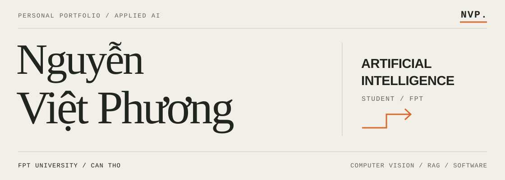

<picture>
  <source media="(max-width: 600px)" srcset="assets/identity-mobile.svg" />
  
</picture>

  <a href="#selected-work">Selected work</a> &nbsp; / &nbsp;
  <a href="#toolkit">Toolkit</a> &nbsp; / &nbsp;
  <a href="#profile">Profile</a>

## Profile

I'm **Nguyễn Việt Phương**, an **Artificial Intelligence student at FPT University, Can Tho, Vietnam**.

I explore how vision and language models become useful applications: from input processing and inference to evidence, APIs and user interfaces. The projects below span multimodal AI, data reasoning and video systems.

## Selected work

### 01 / [ThinkMed](https://github.com/VPhunggggg/thinkmed-multimodal-dermatology-ai)

A multimodal dermatology kiosk connecting computer vision, medical retrieval, Vietnamese voice interaction and patient queues.

`Computer vision` `RAG` `Voice interaction` 
**Inside:** orchestration across vision, language and the kiosk interface.

### 02 / [SheetReason](https://github.com/VPhunggggg/sheetreason-excel-qa)

Excel question answering backed by executable Python evidence, candidate voting and answer-format validation.

`LLM applications` `Python execution` `Data reasoning` 
**Inside:** answer schemas, evidence comparison and result validation.

### 03 / [ExamGuard](https://github.com/VPhunggggg/examguard-phone-detection)

Phone and phone-use detection across images, video and live cameras, with a React interface and Telegram alerts.

`YOLO` `Flask` `React + TypeScript` 
**Inside:** latest-frame workers, camera sessions and asynchronous alerts.

### Further exploration

- **[PigCounter](https://github.com/VPhunggggg/pigcounter-yolo-tracking)** — YOLO + ByteTrack, directional gate-crossing events, per-track state and CSV reporting.
- **[Chess Edition](https://github.com/VPhunggggg/chess-edition-ai)** — Pygame, Negamax/alpha-beta search, iterative deepening and background AI workers.

## Toolkit

Technologies used across these projects:

| Area | Tools & concepts |
| :--- | :--- |
| **Vision & deep learning** | Python · PyTorch · Ultralytics YOLO · OpenCV · ByteTrack |
| **Language & retrieval** | RAG · ChromaDB · LLM APIs · Executable Python reasoning |
| **Application development** | Flask · React · TypeScript · Vite · Pygame |
| **Engineering** | Git · API contracts · Concurrency · State machines · Automated tests |

---

  Project READMEs include architecture, setup instructions and implementation trade-offs.

